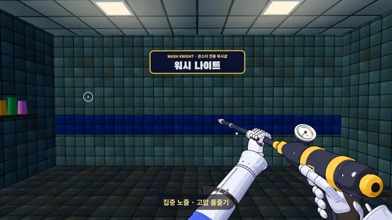
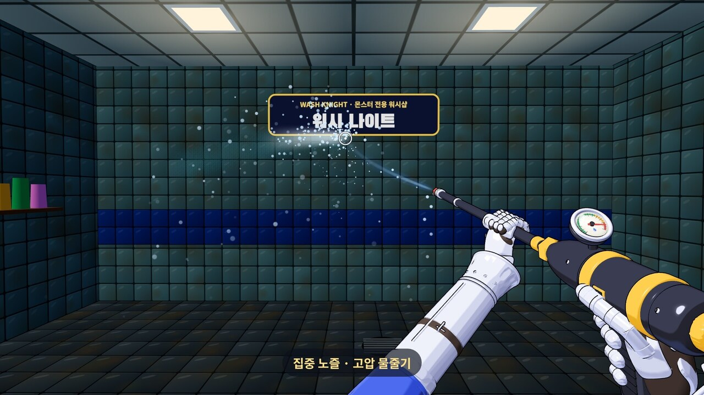
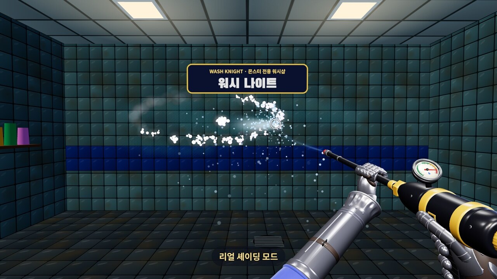

# 워시 나이트 (Wash Knight) · 1인칭 3D 세척건

몬스터 전용 워시샵을 운영하는 기사 청소부가 평범한 청소도구로 RPG 몬스터를 씻겨주는 웹 게임입니다.
이 저장소는 그중 **1인칭 건틀릿 손 + 고압 세척건** 3D 프로토타입이에요. 모바일·PC 브라우저에서 바로 돌아갑니다.



| 툰 셰이딩 | 리얼 셰이딩 |
|---|---|
|  |  |

## 실행

빌드 과정 없는 정적 파일입니다. ES 모듈을 쓰기 때문에 `index.html`을 파일로 바로 열면 안 되고, 아무 정적 서버로 띄우면 돼요.

```bash
python3 -m http.server 8000
# → http://localhost:8000
```

**GitHub Pages로 바로 플레이:** 저장소 Settings → Pages → Branch를 `main` / `(root)`로 저장하면
`https://<아이디>.github.io/<저장소 이름>/` 에서 열립니다.

## 조작

| | 폰 | PC |
|---|---|---|
| 조준 + 분사 | 화면을 누른 채로 끌기 | 마우스로 조준, 누르고 있으면 분사 (Space도 가능) |
| 노즐 교체 | 아래 버튼 (집중 · 넓은 · 세제) | `1` `2` `3` |
| 툰 / 리얼 | 오른쪽 위 버튼 | 오른쪽 위 버튼 |

처음 열면 자동 시연이 돌아가고, 터치하거나 마우스를 움직이면 직접 조작으로 넘어가요.

## 구성

| 파일 | 내용 |
|---|---|
| `index.html` | 세척 부스, 물줄기·부채꼴 분사·거품 이펙트, 입력/HUD, 분사 사운드(Web Audio) |
| `rig.js` | 건틀릿 손 + 세척건 절차적 모델링(three.js), 툰(matcap + 외곽선) / 리얼(PBR) 재질 |
| `assets/wash-knight-fp-rig.glb` | 게임 엔진용 모델 · PBR 재질 · 약 13만 폴리 · 미터 단위 · Y-up, 총구가 -Z 방향 · `index_finger`, `trigger`, `gauge_needle` 노드 분리 |

## 기술 메모

- three.js r160을 CDN import map으로 불러옵니다.
- 손과 총은 별도 뷰모델 카메라로 2패스 렌더링해서 벽에 파묻히지 않아요.
- 폰에서는 갑옷 판 분할을 줄인 가벼운 모델(LOD 0.75)을 쓰고, 프레임이 떨어지면 해상도를 자동으로 낮춰요.
- 세로·가로 화면 구도를 따로 잡았어요.
- iOS는 16.4 이상(import map 지원)이 필요합니다.
