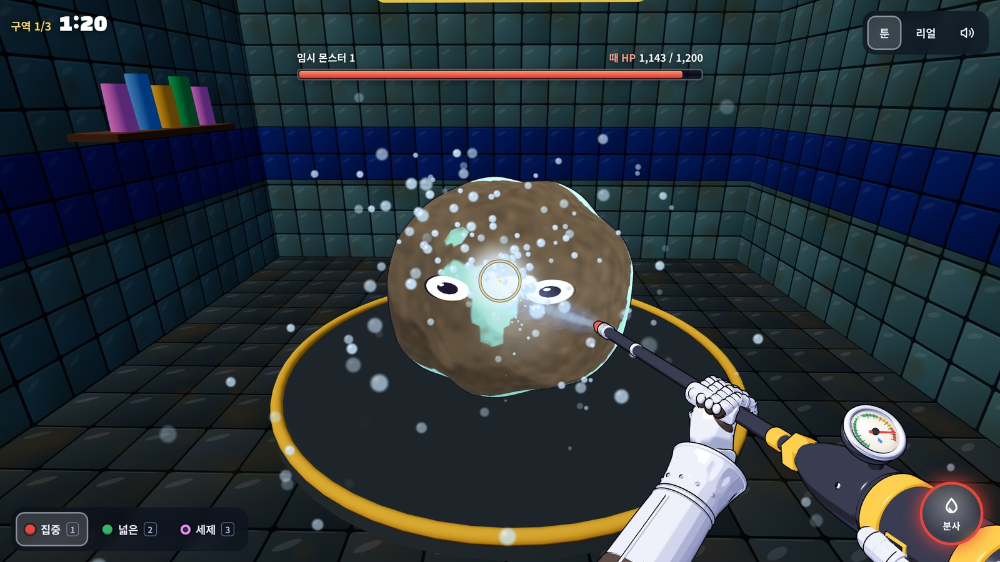
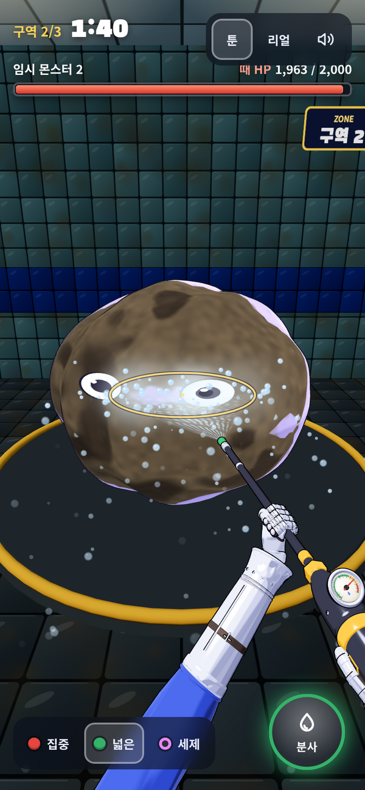

# 워시 나이트 (Wash Knight) · 기본 게임 프로토타입

몬스터 전용 워시샵을 운영하는 기사 청소부가 평범한 세척 도구로 RPG 몬스터를 씻겨주는 웹 게임입니다.
1인칭 건틀릿 손 + 고압 세척건으로 구역 3곳의 몬스터 **때 HP**를 제한시간 안에 0으로 만들면 클리어예요. 모바일·PC 브라우저에서 바로 돌아갑니다.




## 실행

빌드 과정 없는 정적 파일입니다. ES 모듈을 쓰기 때문에 `index.html`을 파일로 바로 열면 안 되고, 아무 정적 서버로 띄우면 돼요.

```bash
python3 -m http.server 8000
# → http://localhost:8000
```

**GitHub Pages로 바로 플레이:** 저장소 Settings → Pages → Branch를 `main` / `(root)`로 저장하면
`https://<아이디>.github.io/<저장소 이름>/` 에서 열립니다.

## 게임 규칙

- 세척장 복도를 따라 **구역 1 → 2 → 3** 순서로 진행해요. 구역마다 임시 몬스터가 한 마리씩 있어요.
- 몬스터 몸에 묻은 때가 **때 HP**예요. 화면 위 HP 바가 다 깎이면(남은 때 5% 이하) 구역 클리어, 다음 구역으로 이동해요.
- 제한시간: 구역 1은 80초, 구역 2는 100초, 구역 3은 120초. 시간이 다 되면 그 구역을 다시 하거나 처음부터 할 수 있어요.
- 세 구역을 다 씻으면 총 세척 시간으로 등급(S·A·B·C)이 나와요.

| 노즐 | 특징 |
|---|---|
| 집중 | 좁고 강함. 딱딱하게 눌어붙은 때나 남은 얼룩 마무리에 좋아요 |
| 넓은 | 넓고 약함. 옅은 때를 한 번에 넓게 쓸어요 |
| 세제 | 거품을 바르면 그 자리는 물(집중·넓은)로 훨씬 빨리 지워져요. 물이 닿으면 거품이 씻겨 나가요 |

조준점 크기는 지금 노즐이 실제로 닦는 범위예요. 집중은 작은 원, 넓은 노즐은 가로로 긴 타원, 세제는 중간 크기로 보이고, 쏘는 동안 살짝 넓어져요.

## 조작

조준점은 항상 화면 가운데에 있고, 물은 가운데로 나가요. 총구도 조준점을 향해요.

| | 폰 | PC |
|---|---|---|
| 시점 이동 | 화면을 끌기 | 화면을 한 번 클릭한 뒤 마우스 이동 (Esc로 해제) |
| 분사 | 오른쪽 아래 **분사 버튼**을 누르고 있기 (누른 채로 끌면 조준도 같이 됨) | 마우스 왼쪽 버튼 누르고 있기 · Space · 분사 버튼 |
| 노즐 교체 | 왼쪽 아래 버튼 (집중 · 넓은 · 세제) | `1` `2` `3` |
| 툰 / 리얼 | 오른쪽 위 버튼 | 오른쪽 위 버튼 |

마우스를 잠글 수 없는 화면(일부 임베드 뷰어)에서는 드래그로 시점을 돌리고, Space나 분사 버튼으로 분사해요.

## 구성

| 파일 | 내용 |
|---|---|
| `index.html` | 게임 진행(구역·타이머·때 HP·등급), HUD, 입력, 물줄기·부채꼴·거품 이펙트, 사운드 |
| `rig.js` | 1인칭 건틀릿 손 + 세척건 절차적 모델링, 툰(matcap + 외곽선) / 리얼(PBR) 재질 |
| `world.js` | 맵: 세척 구역 3칸이 나란히 붙은 세척장 |
| `monster.js` | 임시 몬스터(덩어리) · 정점마다 때/세제 양을 저장하고 셰이더로 표시 |
| `assets/wash-knight-fp-rig.glb` | 게임 엔진용 손 + 세척건 모델 · PBR 재질 · 약 13만 폴리 · 미터 단위 · Y-up, 총구가 -Z 방향 |

## 밸런스 조정

`index.html` 위쪽 `ZONES`(몬스터 크기·때 양·제한시간·HP), `FP`(노즐별 범위와 세기), `CLEAR_AT`(클리어 기준), `GRADES`(등급 시간)를 고치면 돼요.
세제를 바른 곳에서 물이 몇 배 빨라지는지는 `monster.js`의 `SOAP_BOOST`예요.

## 기술 메모

- three.js r160을 CDN import map으로 불러옵니다.
- 손과 총은 별도 뷰모델 카메라로 2패스 렌더링해서 벽에 파묻히지 않아요. 총구는 매 프레임 조준점 방향으로 보정돼요.
- 폰에서는 갑옷 판과 몬스터를 더 가벼운 모델로 쓰고, 프레임이 떨어지면 해상도를 자동으로 낮춰요.
- iOS는 16.4 이상(import map 지원)이 필요합니다.
- 임시 몬스터는 진짜 몬스터 모델이 나오면 교체할 자리예요.
